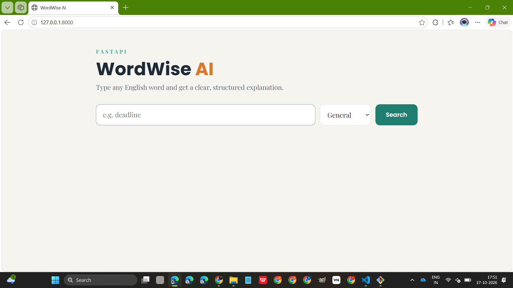
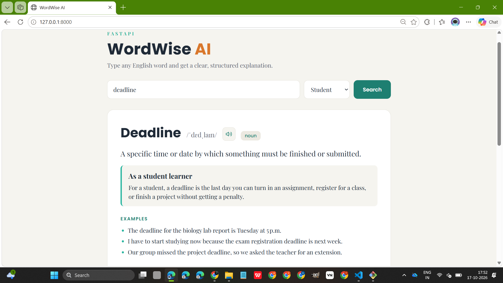
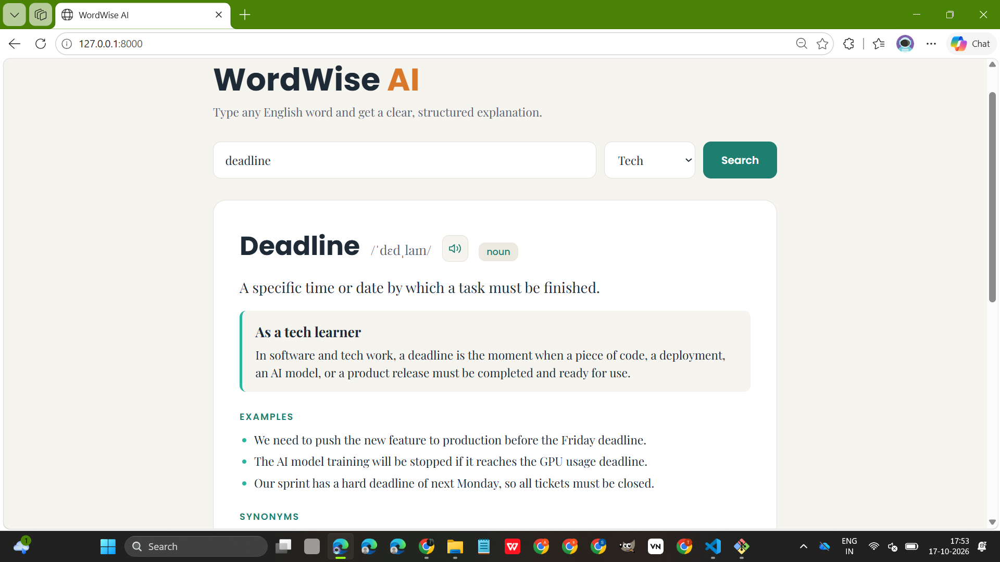

# WordWise AI

An AI-powered English word explainer built while learning **FastAPI**.
Type a word, pick your context (General, Student, Corporate, Tech), and get a clear, structured explanation with examples from your world.

## Screenshots

<p align="center">
  <br><br>
  <br><br>
  
</p>

## What I learned (FastAPI)

- Creating endpoints with `@app.get`
- Path parameters (`/word/{term}`) and query parameters (`?context=student`)
- Input validation with type hints and an `Enum` (invalid values return 422)
- Pydantic models for structured responses
- Error handling with `HTTPException`
- Serving an HTML page with `FileResponse`
- Testing endpoints in Swagger UI (`/docs`)

The LLM (Groq, via LangChain) returns free-form text, so a `PydanticOutputParser` turns it into JSON that the page can render consistently.

## Project structure

```
wordwise-ai/
├── app/
│   ├── main.py              # routes (FastAPI)
│   ├── schemas.py           # Pydantic models
│   ├── services/
│   │   └── word_service.py  # LLM + parser
│   └── static/
│       └── index.html       # frontend
└── screenshots/
```

## Run it

1. Install dependencies:
   ```
   pip install fastapi uvicorn langchain langchain-groq python-dotenv
   ```
2. Add a `.env` file in the folder **above** `wordwise-ai` (the repo root) with your Groq API key:
   ```
   GROQ_API_KEY=your_key_here
   ```
3. Start the server from the `wordwise-ai` folder:
   ```
   uvicorn app.main:app --reload
   ```
4. Open http://127.0.0.1:8000 for the app, or http://127.0.0.1:8000/docs for Swagger UI.
